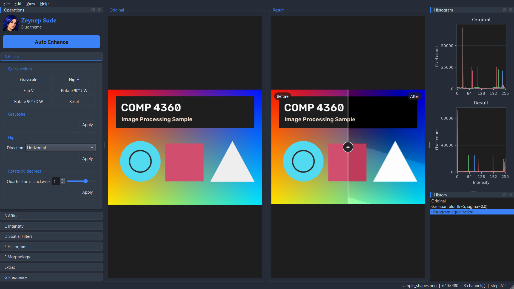
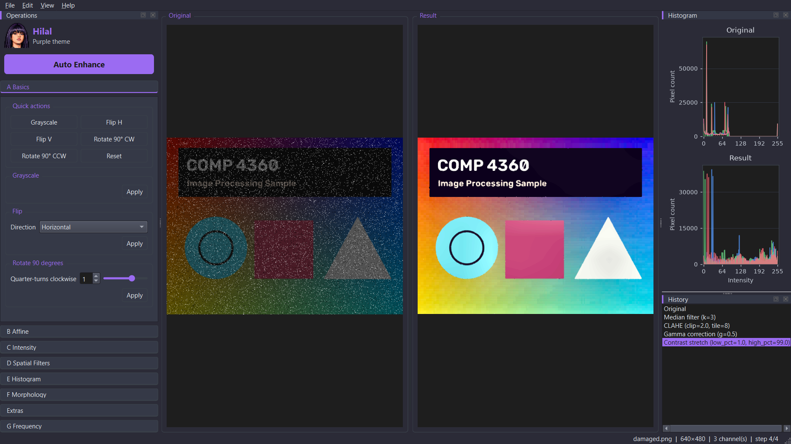
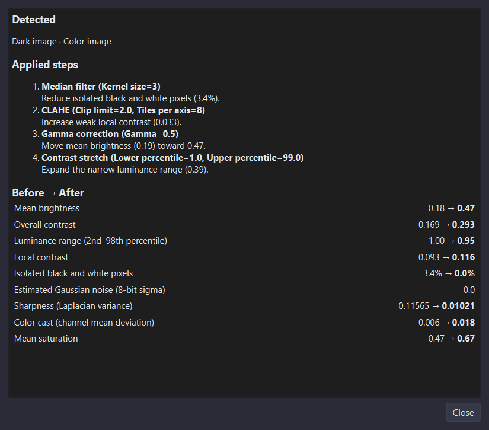
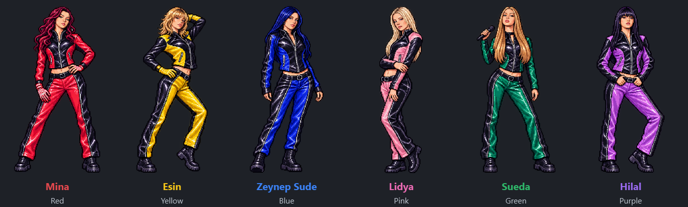
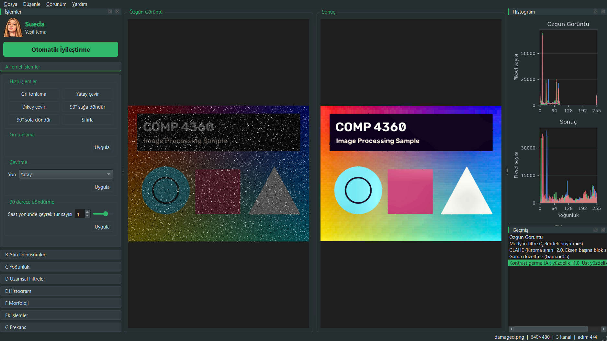

<div align="center">

# DIP Midterm — Image Processing Studio

**A desktop image-processing app built with PySide6 and OpenCV for COMP 4360 Digital Image Processing.**

Open an image, apply 30 classic operations with a live preview, compare the before and after views side by side, and let **Auto Enhance** analyze the image and fix it for you, with an explanation of each step.




</div>

---

## Highlights

- **Two linked panels.** Original and Result zoom and pan together. A draggable before/after wipe slider compares them directly, and the pixel inspector shows coordinates and values under the cursor.
- **Live preview.** Every slider and spin box updates the result as you change it. Click **Apply** to keep the result, and use undo, redo or the history list to go back.
- **Auto Enhance.** The app measures noise, color cast, contrast, exposure and sharpness. It then chooses fitting operations and explains the reason for each one, with before and after numbers. [How it works ↓](#auto-enhance)
- **Frequency domain.** View the FFT spectrum and apply ideal, Gaussian or Butterworth low-pass, high-pass, band-pass and band-stop filters, with a live Frequency Inspector.
- **English / Türkçe.** Switch the whole interface between English and Turkish while the app is running.
- **Six color themes.** Each theme has its own pixel-art figure.
- **Single executable.** `DIP_Midterm.exe` runs on Windows without installing Python.

## Features

| Group | Operations |
|---|---|
| **A · Basics** | Grayscale, flip horizontal/vertical, rotate 90° clockwise and counterclockwise, reset to original |
| **B · Affine** | Rotation by any angle, uniform or separate X/Y scaling (5 interpolation modes), translation, shear in X, Y or both |
| **C · Intensity** | Contrast stretching (percentiles), gamma correction slider, negative |
| **D · Spatial filters** | Mean/box, Gaussian, median, Laplacian, Sobel X/Y/both |
| **E · Histogram** | Live B/G/R histograms for both panels (docked or in their own window), histogram equalization |
| **F · Morphology** | Global or Otsu thresholding, erode, dilate, open, close (rectangular, elliptical or cross kernel) |
| **Extras** | CLAHE, unsharp mask, Canny edges, bilateral filter, gray-world white balance, sepia, noise generator |
| **G · Frequency** | FFT magnitude spectrum, frequency-domain filtering, Frequency Inspector (`Ctrl+F`) |

**Workflow:** drag and drop, recent files, 8 built-in sample images (noisy, low-contrast, document, binary, periodic noise and more), Save Result As, Use Result as Original, Unicode file paths, and keyboard shortcuts for common actions.

## Auto Enhance



Press **Auto Enhance** (`Ctrl+E`). It uses no AI service or network: the app follows fixed rules based on classical image measurements, so the same image always gives the same result.

1. **Measure.** The app measures mean brightness, the 2nd–98th percentile luminance range, local contrast, salt-and-pepper fraction, Gaussian noise σ (a MAD estimate on a high-pass residual), sharpness (variance of the Laplacian) and gray-world color cast.
2. **Decide in a fixed order:**
   1. Remove noise first, with a median filter for salt-and-pepper noise or a bilateral filter for Gaussian noise. Raising contrast first would amplify the noise.
   2. White-balance color images with a channel cast.
   3. Stretch a narrow luminance range and add CLAHE when local contrast is weak.
   4. Apply gamma to dark or bright images. The exponent is computed, not guessed: `g = log(0.47) / log(mean)`.
   5. Sharpen with an unsharp mask last, and only if no noise remains.
3. **Verify each step.** Each candidate step runs on a copy and is measured again. A step is kept only if it improves the metric it targets.
4. **Explain.** Each kept step becomes its own history entry, so you can undo it alone. A report lists what was detected, why each step was chosen, and the before and after values of every metric.

<p align="center"></p>

Images that are already well exposed, clean and sharp are left unchanged.

## Themes and languages

<p align="center"></p>

Choose a theme from **View → Theme**. Each theme recolors the interface and the plots and changes the figure shown in the empty panel, the operations header and the window icon. Choose the language from **View → Language**. The change applies immediately: menus, operations, parameters, tooltips, plots, history and reports are all translated, and the current work is kept.



## Getting started

### Run the executable (Windows)

Download `DIP_Midterm.exe` from the [Releases](../../releases) page and double-click it. The first start takes a few seconds because the single-file executable unpacks itself.

### Run from source

```bat
git clone https://github.com/Houzcetin/DIP_Midterm.git
cd DIP_Midterm
setup.bat        :: creates .venv with Python 3.11, installs requirements and starts the app
run.bat          :: later runs
```

Or manually:

```bash
py -3.11 -m venv .venv
.venv\Scripts\pip install -r requirements.txt
.venv\Scripts\python src\main.py
```

### Build, test and package

```bat
build.bat                                   :: PyInstaller → dist\DIP_Midterm.exe
.venv\Scripts\python -m pytest -q           :: 532 tests
dist\DIP_Midterm.exe --selftest out         :: headless check of the frozen exe
package.bat /build                          :: exe + README.pdf + src → submission zip
.venv\Scripts\python tools\make_screenshots.py   :: regenerates the images in media/
```

## Keyboard shortcuts

| Keys | Action | Keys | Action |
|---|---|---|---|
| `Ctrl+O` | Open | `Ctrl+0` | Fit to window |
| `Ctrl+S` | Save result as | `Ctrl+1` | Actual size |
| `Ctrl+Z` / `Ctrl+Y` | Undo / redo | `Space` | Toggle the original in the Result panel |
| `Ctrl+R` | Reset to original | `Ctrl+B` | Before/after wipe |
| `Ctrl+E` | Auto Enhance | `Ctrl+F` | Frequency Inspector |

Use the mouse wheel to zoom around the pointer, drag to pan, and double-click to fit.

## Project structure

```
src/
├── main.py              entry point and --selftest
├── core/                image state (history, undo/redo), sample images
├── ops/                 pure NumPy/OpenCV operations, no UI code
│   ├── registry.py      operation and parameter metadata that drives the UI
│   ├── auto.py          Auto Enhance analysis and planning
│   └── basics · affine · intensity · filters · histogram · morphology · extras · frequency
└── ui/                  PySide6 widgets: main window, image view, panels, themes, i18n, reports
tests/                   pytest suite (operations, UI, themes, i18n, Auto Enhance, self-test)
tools/                   README.pdf generator, screenshot generator, PyInstaller hooks
```

The operations are plain functions that take and return NumPy arrays. The interface is built from the metadata in `ops/registry.py`, so adding an operation takes one function and one registry entry.

## Known limitations

- Processing is 8-bit. 16-bit images are normalized to 8 bits when loaded, and alpha is discarded.
- Laplacian, Sobel, Canny, threshold and the FFT spectrum produce grayscale output.
- History keeps up to 30 snapshots in memory. Very large images slow the live preview.
- Auto Enhance uses heuristic thresholds. Fine texture can look like noise, and scenes dominated by one color can trigger white balance.

---

<sub>Built by Oğuz Çetin for COMP 4360 Digital Image Processing at Yaşar University, Fall 2026. The pixel-art figures are fan art inspired by the Turkish pop group MANIFEST and are used only as theme decoration.</sub>
